 

 

---

  

---

<b>📂 More in the vault</b> (click to expand)

 

| Repo | Stack |
|:--|:--|
| [crowd-fund](https://github.com/rootds-coder/crowd-fund) | TypeScript |
| [mobiledoctor](https://github.com/rootds-coder/mobiledoctor) | EJS |
| [test](https://github.com/rootds-coder/test) | HTML |

---

  

---

  

---

Auto-updated every 12 hours from the GitHub API by a GitHub Action in this repo.

---

I'm always up for **interesting engineering problems, thoughtful collaboration and useful open-source projects.** Browse a repo, open an issue, or start a technical conversation on GitHub.

